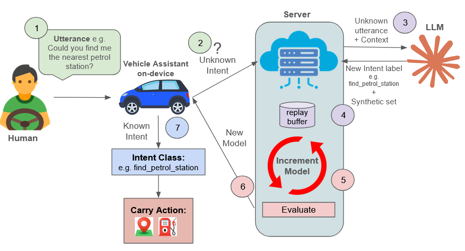

# incremental_learning_on_the_edge
development of an end-to-end pipeline of a system orchestration that handles incremental learning of natural language in an edge device in the Connected and Automated Mobility (CAM) and Intelligent Transport Systems (ITS) ecosystem

[](https://colab.research.google.com/github/BrunoSantome/incremental_learning_on_the_edge/blob/main/Demo_Run_ME.ipynb)

## How it works



1. The driver says something to the vehicle assistant, e.g. "could you find me the nearest petrol station?".
2. The intent classifier on the device does not know the intent (Energy OOD score below the threshold), so the
   utterance is escalated to the server.
3. The server sends the unknown utterance with some context to an LLM (Claude), which gives back a name for the new
   intent (e.g. `find_petrol_station`) and a synthetic training set.
4. The synthetic set is combined with a replay buffer of the old intents so they are not forgotten.
5. The model is retrained into a new version (V1, V2, ...) and evaluated on old and new intents.
6. The new model is sent back to the vehicle.
7. The next time the intent is recognised on the device and the action is carried out.

The starting model (V0) is `jhu-clsp/ettin-encoder-68m` distilled from DeBERTa-v3-large and trained on 15 intents of
the MASSIVE dataset. In the simulation the edge and the server run on the same machine and talk through a shared
folder (`src/mailbox/`).

## Running the demo (Google Colab)

The easiest way is the Colab notebook, click the "Open In Colab" badge above
(`Demo_Run_ME.ipynb` in the root of the repo). You type utterances and see the device detect the unknown
ones, the server learn them and the device update itself.

You only need a Google account and an Anthropic API key ([console.anthropic.com](https://console.anthropic.com/)).
Every new intent calls Claude, so it uses a bit of API credit. W&B is not needed. The code is cloned from this repo
and the V0 model is downloaded from Hugging Face by the notebook itself.

1. Open the notebook and select a GPU: Runtime > Change runtime type > T4 GPU.
2. Add the key as a Colab secret: key icon on the left sidebar > Add new secret, name `ANTHROPIC_API_KEY`, enable
   notebook access. If you skip this the notebook asks for the key.
3. Run the cells in order. When the input box appears, write an utterance and press Enter, `quit` to finish.

Some utterances to try: "what's the weather like tomorrow" (known), "open the front window of the car" (unknown,
learned as V1), then "roll down the passenger window" (should now be recognised). An escalation takes a few minutes
on a T4. The notebook also has a recorded run to compare with.

## V0 checkpoint

The checkpoint is around 270 MB, too big for GitHub, so it is on Hugging Face:
[Brunaquen/ettin-68m-massive15-v0](https://huggingface.co/Brunaquen/ettin-68m-massive15-v0). The notebook downloads
it automatically. If you place it by hand, the files (`config.json`, `model.safetensors`, `history-student1.json`)
have to be in:

```
src/outputs/checkpoints/student_ettin_68m_distill_v0/
```

The new versions (`student_ettin_68m_distill_v1`, `_v2`, ...) are saved next to it during the simulation.

## Running it locally

You need an NVIDIA GPU with CUDA, on CPU the retraining is very slow.

```bash
git clone https://github.com/BrunoSantome/incremental_learning_on_the_edge.git
cd incremental_learning_on_the_edge
python -m venv .venv
source .venv/bin/activate    # on Windows: .venv\Scripts\activate
pip install -r requirements.txt
```

If pip installs the CPU version of PyTorch, install the CUDA one from [pytorch.org](https://pytorch.org/get-started/locally/).

Download the V0 checkpoint:

```bash
huggingface-cli download Brunaquen/ettin-68m-massive15-v0 config.json model.safetensors history-student1.json --local-dir src/outputs/checkpoints/student_ettin_68m_distill_v0
```

Create a `.env` file in the root of the repo (it is in `.gitignore`):

```
ANTHROPIC_API_KEY=sk-ant-...
WANDB_MODE=disabled
```

And run the simulation from `src/`:

```bash
cd src
python run_simulation.py
```

Write the utterances at the `utterance (exit/quit to stop)>` prompt. With `--verbose` the full training logs are shown.

Each run saves a `log.json` in `src/outputs/results/e2e_interactive_<date>/` with every utterance, prediction,
energy score, escalation, timings and the per-intent F1. Every run starts again from V0.

## Repository structure

- `src/run_simulation.py`: entry point of the end-to-end simulation
- `src/config/config.yaml`: dataset, models, OOD and LLM settings
- `src/edge/`: inference and Energy OOD detection on the device
- `src/server/`: LLM client that names the new intents and generates the utterances
- `src/core/`: data loading, intent registry, training and distillation, evaluation
- `src/shared/mailbox.py`: communication between edge and server (escalations and releases)
- `src/experiments/`: end-to-end loop, OOD benchmark, ablations and scripted runs
- `Demo_Run_ME.ipynb`: the Colab demo
- `notebooks/`: experiments and analysis

## Credits

- [MASSIVE](https://huggingface.co/datasets/qanastek/MASSIVE) dataset (Amazon, CC BY 4.0)
- [jhu-clsp/ettin-encoder-68m](https://huggingface.co/jhu-clsp/ettin-encoder-68m) as student model
- [microsoft/deberta-v3-large](https://huggingface.co/microsoft/deberta-v3-large) as teacher model
- Claude (Anthropic API) for the synthetic data generation

## License

Apache 2.0, see [LICENSE](LICENSE).
